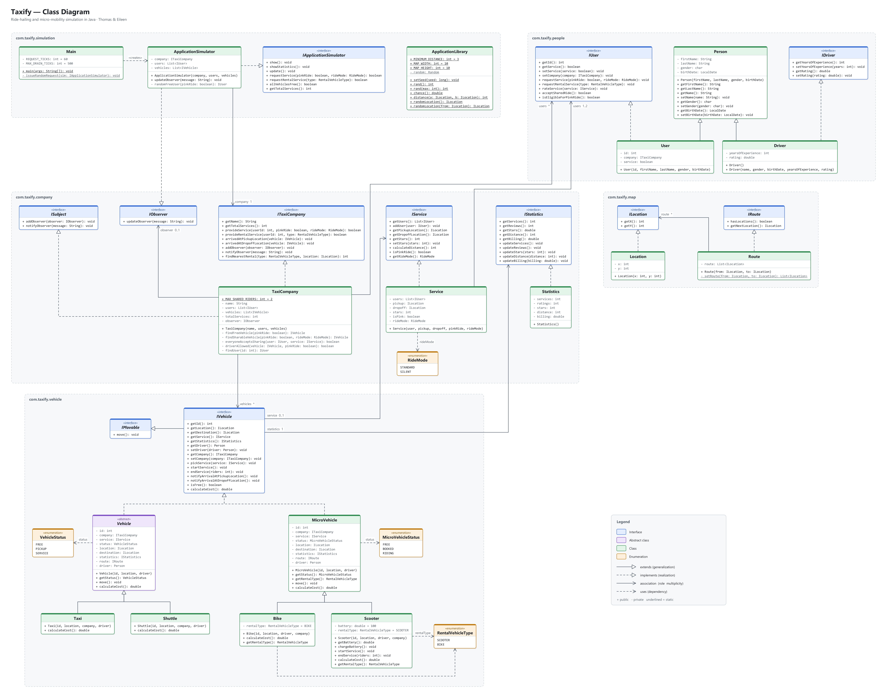

# Taxify

[](https://github.com/tomup5/Taxify/actions/workflows/ci.yml)


A ride-hailing and micro-mobility simulation written in object-oriented Java. Users on a city grid request taxis and shuttles, share rides, ask for women-driven "pink" rides, and rent bikes and battery-powered scooters. The company matches each request to a vehicle, the vehicles drive their routes step by step, and the simulator reports billing, distance and ratings for each vehicle.

## Features

- **Ride matching**: assigns each request to a free taxi or shuttle; requests from users already on a ride are rejected.
- **Shared rides**: when no vehicle is free, a user can join a ride that is on its way to a pickup (up to 2 riders). Every passenger has to agree, and the ride mode has to match. Each rider pays 60% of the fare.
- **Pink rides**: rides with a female driver, offered to women and children.
- **Ride modes**: Standard or Silent.
- **Micro-mobility rentals**: finds the nearest free bike or scooter. Each ride uses 25% of a scooter's battery, and a scooter recharges before a ride if its battery is at 25% or lower.
- **Per-vehicle statistics**: services, distance, billing, reviews and average rating.
- **Reproducible runs**: all randomness comes from one seedable source, so a given seed always produces the same simulation.

### Pricing

Fares are based on the Manhattan distance `d` between pickup and drop-off.

| Vehicle | Fare |
|---|---|
| Taxi | `2 × (1 + d)` |
| Shuttle | `1.5 × (1 + d)` |
| Bike | `1 + 0.25 × d` |
| Scooter | `1 + 0.15 × d` |
| Shared ride | 60% of the fare per rider |

## Quick start

You need JDK 17 or newer. The Gradle wrapper is included.

```bash
./gradlew run                 # run a simulation with a random seed
./gradlew run --args="42"     # run a reproducible simulation with seed 42
./gradlew test                # run the test suite
```

On Windows, use `gradlew.bat` instead of `./gradlew`.

### Sample output

```text
Taxify simulation (seed 42)

User 6 requests a Standard service from (3,0) to (4,3), the ride is assigned to Taxi 0 at location (3,3)
User 5 rents a SCOOTER from (4,6) to (7,6), the rental is assigned to Scooter 101 at location (4,6)
Scooter 101 picks up user(s) 5
User 10 requests a Standard service from (9,3) to (1,9), the ride is assigned to Taxi 1 at location (5,5)
Taxi    0 picks up user(s) 6
User 9 rents a BIKE from (1,5) to (6,9), the rental is assigned to Bike 102 at location (1,5)
...

Taxify statistics

Taxi      0  4 services  28 km.  64.00 eur.  4 reviews 2.25 stars
Shuttle   5  3 services  21 km.  36.00 eur.  1 reviews 2.00 stars
Scooter 101  2 services  14 km.   4.10 eur.  0 reviews 0.00 stars
Bike    102  2 services  21 km.   7.25 eur.  2 reviews 3.50 stars
...
```

## Design



*Full-size diagram: [docs/class-diagram.png](docs/class-diagram.png)*

- **Program to interfaces.** Every major component sits behind an interface (`ITaxiCompany`, `IVehicle`, `IService`, `IUser`, `IRoute` and others), and the classes depend on those interfaces rather than on each other.
- **Observer pattern.** `TaxiCompany` is the subject (`ISubject`) and `ApplicationSimulator` is the observer (`IObserver`). Every event (request, pickup, drop-off, battery update) is sent to the observer, so the company logic never prints anything itself.
- **Inheritance for vehicle types.** `Taxi` and `Shuttle` extend the abstract `Vehicle`; `Bike` and `Scooter` extend `MicroVehicle`. Subclasses override `calculateCost()` for their pricing, and `Scooter` overrides `startService()` and `endService()` to manage its battery. `User` and `Driver` both extend `Person`.
- **Enums for state.** `VehicleStatus` (FREE → PICKUP → SERVICE), `MicroVehicleStatus` (FREE → BOOKED → RIDING), `RideMode` and `RentalVehicleType` replace free-text strings and flags.

### How a ride works

1. `ApplicationSimulator` picks a user who isn't riding and asks `TaxiCompany` for a ride.
2. `TaxiCompany` finds a free vehicle, or a ride the user can share, creates a `Service` and calls `vehicle.pickService(service)`.
3. Each tick, `ApplicationSimulator.update()` calls `move()` on every vehicle. Each vehicle follows its `Route` one grid cell at a time.
4. When a vehicle arrives, it calls back `arrivedAtPickupLocation` or `arrivedAtDropoffLocation`. At drop-off, the company releases the passengers, lets them rate the ride, and the vehicle records the trip in its `Statistics`.

### Project layout

```text
src/main/java/com/taxify/
├── company/      TaxiCompany, Service, Statistics, RideMode, observer interfaces
├── people/       Person, User, Driver
├── vehicle/      Vehicle, Taxi, Shuttle, MicroVehicle, Bike, Scooter, status enums
├── map/          Location, Route (grid movement)
└── simulation/   Main, ApplicationSimulator, ApplicationLibrary (seedable RNG, distance)
src/test/java/com/taxify/    JUnit 5 tests
docs/                        class diagram and the Java2D program that draws it
```

## Testing

There are 51 JUnit 5 tests, and GitHub Actions runs them on every push.

- **Unit tests**: routing, fares, shared-ride billing, scooter battery, statistics, pink-ride eligibility.
- **Ride assignment tests**: double-booking prevention, pink rides only going to female drivers, sharing consent and capacity, nearest-rental search, the full pickup-to-drop-off lifecycle.
- **Simulation tests**: 15 seeded simulations. After every step, each test checks that no user is in two rides at once and that each user's riding flag matches the vehicles. At the end, it checks that every ride finished.

## Project history

Taxify started as a five-sprint team project for a software engineering course, built with [Eileen Luo](https://github.com/cinnamon-cicada). Each sprint added features: the core domain model, vehicle types, the Observer-based simulator, drivers with pink and silent rides and shared rides, then bike and scooter rentals.

After the course I reworked it into a standalone project:

- moved it to a standard Gradle layout with packages
- added the test suite and CI
- fixed bugs the tests exposed: double-booked users, a reversed pink-ride age check, a "nearest scooter" search that measured each scooter's distance to itself, scooters starting with an empty battery, NaN ratings, and a shared-ride loop that could hang
- replaced free-text ride modes with an enum and made runs reproducible with a seed
- redrew the UML class diagram

The full sprint-by-sprint history is in the commit log.
